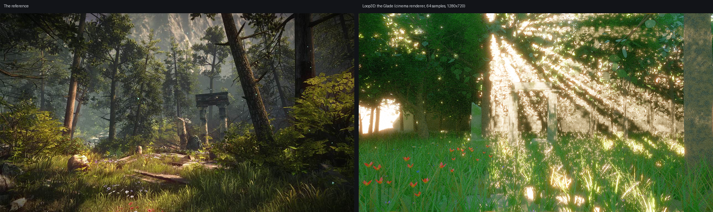

# The Showcase: what was built, why, and how it went

This project (`projects/showcase/`, branch `project/showcase`) is the start of a showcase
that will grow: one hero room made as well as the engine allows, and a hall of smaller
rooms that each show one thing the engine does, **before and after**.

*Left: the reference picture. Right: the Glade, rendered by Loop3D's cinema renderer
(`loop render`). Below it on the branch: `stills/showcase_glade.png`.*

---

## 1. What I built, and why

### The model library (in the engine, for every project)

The reference is a forest ruin: grass, ferns, flowers, butterflies, motes of light, fluted
stone columns, fallen logs. The engine had trees, rocks and land, but none of the rest, and a
script can't make a new shape from scratch. So I added them to the engine as new words of the
language. Each is a generator in `engine/geometry/plants.cpp` plus a word in
`engine/script/scene_api.cpp`, and each has a test.

| Word | What it makes | Why it's built this way |
|---|---|---|
| `grass(around, radius, density, height, …)` | a meadow of curved blades, on the land | four tuft shapes shared by thousands of copies: cheap to draw, varied by turn, height and a dry-grass share |
| `fern(at, size, …)` | arching fronds of paired leaflets | leaflets are cards cut to a leaf outline, so they're light but read as leaves |
| `flower(kind, at)`, `flowers(around, count, kinds)` | daisies, violets, poppies, bluebells, in drifts | flowers grow in clumps of one kind, like real ones |
| `column(at, height, broken)` | a fluted column with base and capital; broken ones snap partway up with a ragged top | made on the lathe principle with real flutes and a slight taper (entasis) |
| `log(at, length, radius)` | a fallen, knobbly log with cut ends | bark that follows noise, end rings in old wood |
| `butterfly(around, color)` | flutters between flowers, sits with wings fanning | **moved by the engine itself every step**, so a scene doesn't pay script time for it |
| `fireflies(around, count)` | glowing motes that drift and twinkle | the same: engine-moved; they twinkle by size, so no material changes per frame |
| `tree(…)` now gives back the tree; `tree`/`forest` take `leaf_size:` and `detail:` | handles to hide or move trees; smaller, fuller leaves; light far-off trees | the defaults' leaves were about 40 cm across, too big for this picture; `detail: 0.45` halves the triangles of far trees |

Also new: one handle ("a model") moves or hides every part of a model. There are 17 new
materials: `fern`, `fresh leaves`, `blades`, `dry blades`, `daisy`, `violet`, `poppy`,
`bluebell`, `pollen`, `stem`, three butterfly wings, `firefly`, `ruin stone`, `mossy stone` and
`forest floor`. They're documented in `docs/LANGUAGE.md` under "Nature, ruins and creatures",
and they appear in the editor's Content panel and word suggestions.

### The hero room: The Glade (`showcase_glade.loop`)

A clearing in a forest that works as a room. A ring of pines and oaks makes the walls, a
cliff of weathered rock stands behind, and the sky is the ceiling. Every choice follows the
reference:

- **Composition:** you look up an old path of sunken stone slabs toward the ruin in the
  middle of the frame, with a big pine trunk on the right edge and foliage framing the top, as
  in the picture.
- **The ruin:** two fluted columns under a mossy lintel, a third broken one beside them, a
  fallen drum, a mossy boulder and slabs of the old floor.
- **The green life:**
  - grass: about 6,000 tufts, with a dry share
  - flowers: about 280 (daisies, violets, bluebells and a drift of red poppies near you, as in
    the picture's foreground)
  - 12 ferns at the column feet and edges
  - bushes in "fresh leaves", the bright yellow-green of the backlit bushes in the reference
- **Life:** 10 butterflies over the flowers and 70 glowing motes in the light, like the
  reference's floating specks.
- **Light:**
  - the sun is low (24°), behind and slightly left, warm (5000 K) and a little wide (0.7°)
    for soft shadows, so the canopy and grass are backlit
  - a physical sky with haze 3.6, and a green-tinted ground for the bounce light
  - a thin height fog that glows toward the sun; in the cinema renderer that fog carries real
    shafts of light through the gaps in the canopy, the reference's god rays
- **Sound:** birds, a breeze, a stream off to the left (placed in 3D), crickets low.
- **Film:** a natural look, slightly warm and saturated, with gentle bloom, halation,
  vignette, a trace of grain and sharpening.
- **Shots:** a slow push up the path, an orbit round the ruin, and an 85 mm f/2 close-up
  of the flowers.
- **Before and after:** a glowing plinth by the path (behind the first shot's camera).
  Press Use there:
  - **before** is the blockout every scene starts as: land, trees and a grey ruin under flat
    light with no fog
  - **after** is everything

### The hall and its rooms

`showcase_hall.loop` is a long stone gallery with ten glowing doors and the glade at the far
end. Walk up to a door and a line tells you what's inside; walk through to go in. Each room
has a glowing plinth: press Use for before and after.

| Room | Before | After |
|---|---|---|
| Materials | every ball plain grey | every named material in the library (about 76), on plinths |
| Light | one bare bulb, no lamp shadows | a warm lamp, a cool lamp, a spotlight on a bust, a softbox, ray-traced lamp shadows (4 lamps, 4 rays) |
| Sky | a flat blue | the physical sky as the sun goes round: noon, sunset, stars |
| Fog | clear air | height fog glowing in a low sun, among columns and pines |
| Physics | weightless crates and balls hanging in the air | gravity: the stack falls and an iron ball knocks it, every knock sounding like its material |
| People | three people standing | one walks a loop, one sits on the bench, one turns to watch you |
| Sound | silence in a dead room | fire, a fountain, birds and a bell placed in 3D, and a great hall's echo |
| Film | the natural look | the other eleven looks in turn, with cinema bars every other one |
| Story | the keeper says nothing | the keeper talks, asks which room you liked with buttons, and remembers it |
| Settings | the project's settings | the scene changes the engine's own settings: slow motion, long reading time, fast walking, stronger sky light |

`showcase_common.loop` holds what every room shares: the before/after plinth (`before_after`),
the room shell, the door back and the start position.

---

## 2. Where it falls short of the reference, step by step

1. **God rays live.** The cinema renderer traces real shafts of light through the fog. The
   live renderer's fog has no shadows in it, so in the player and editor the haze glows but
   there are no shafts. **Needed:** a volumetric pass (ray-marched fog with the sun's
   shadow map).
2. **Scanned detail.** The reference is made of photo-scanned bark, stone and moss. Loop3D
   has no image textures wired yet (the PNG reader exists; `Pattern::kImage` is switched off
   in the live renderer and no script word sets an image), so every surface here is
   procedural noise. It reads well from a distance but not up close. **Needed:** image
   textures from scripts, in both renderers.
3. **Wind.** Nothing sways. Moving thousands of grass tufts or leaf cards each frame would
   re-send every copy to the GPU (the renderer re-sorts and re-uploads all instances when
   anything moves). **Needed:** sway in the vertex shader (a wind setting, no CPU work).
4. **Foliage density.** The reference's undergrowth is far denser and finer. Here grass is
   about 6,000 tufts and trees are cards on branching tubes. More would need GPU culling and
   levels of detail (both "Not built yet" in the settings), or the frame rate drops.
5. **Ivy and moss on the stone.** The moss is a colour in the stone's pattern, not geometry
   growing on it.
6. **Glowing motes lighting things.** They glow and bloom but light nothing live (only the
   path tracer treats glowing things as lights).
7. **Text in the world.** There's no 3D text, so the hall's doors are named by a line on
   screen when you walk up, not by a sign.
8. **Weight.** The glade is about 4.6 million triangles (after the new `detail:` for far
   trees; 9.25 million before). A desktop GPU draws it. A phone will be slow on High: use Phone
   quality, and lower Forest density in Project Settings → World before the scene builds.
   **On this test machine** (a software GPU on the CPU) the browser dropped the GPU on the
   glade, so the live pictures here come from the cinema renderer.

---

## 3. How it was to work with the engine

### What made it easy

- **The language reads like the scene.** `column at: vec(1.15, 0, -8), height: 3.5`,
  `sun elevation: 24 deg, kelvin: 5000`, `fog 0.008, glow: 0.78`. Real units (deg, m, lux,
  kelvin, mm) meant I could set light the way a cinematographer would, and it came out
  believable the first time.
- **Fast checks.** `loop check` parses in milliseconds, `loop run` builds the whole glade
  in about a second, and `loop play` drives every room's before/after switch and every door
  with no window. I caught every script mistake in seconds.
- **Error messages teach.** "`forever` can't be used here", "`after` can't name a setting;
  pick another name, like `after_at`", "did you mean …?". I fixed every mistake from the
  message alone.
- **The cinema renderer.** Physically based light, real fog shafts, translucent leaves and
  depth of field came for free, and a draft render took about three minutes.
- **Adding to the engine is clean.** A generator in `plants.cpp`, a word in `scene_api.cpp`
  with `cachedMesh` and `Args`, a test, and it's usable from scripts, documented and in the
  editor. Each new word took a few minutes.
- **Settings by name.** The glade sets what it needs (`setting "render.lamps", 0`,
  `world.patternFade`, `story.speakerNames`) right in its script.

### What made it hard

- **No way to make shapes in a script.** Every model the picture needed had to become C++
  first. A `mesh(points, faces)` word, or importing glTF models, would let artists add
  models without touching the engine.
- **Reserved words as names.** `from`, `to`, `after` and `forever` are keywords, so a
  helper like `lintel(from, to)` has to use other names. The messages say so clearly, but
  it trips you every time.
- **Small syntax surprises.** Loops are `for each x in list` and `repeat forever`, not
  `for x in` or `forever`. Single-line `fn` only.
- **Heavy scenes have no safety net.** There's no culling or levels of detail, and every
  copy is drawn every pass. I had to count triangles myself (I added that count to
  `loop run`) and add `detail:` to keep the glade drawable.
- **Live vs cinema differ a lot here.** The best features of this picture (god rays, glowing
  motes lighting the leaves) exist only in the cinema renderer, so the live view is a
  noticeably plainer version of the still.
- **Testing in this sandbox.** The GPU here is software, so live frames take seconds, heavy
  scenes lose the GPU, and anything visual had to be judged from cinema renders.

### Verdict

For a scene like this, Loop3D is pleasant and quick to write and very good at light. Most of
the gap to the reference is **assets** (image textures, model import, denser foliage) and
**live volumetrics**, not the language or the lighting.

---

## 4. Running it

- **Editor:** open `editor.html`, then Project → Showcase → The Glade. Press Play to walk
  and Movie for the shots.
- **Player:** `index.html#showcase_glade`, or `#showcase_hall` for the rooms.
- **Cinema still:** `./build/loop render projects/showcase/showcase_glade.loop` writes
  `showcase_glade.png` (64 samples at 1280×720: about 40 minutes on 4 CPU cores).
- **Checks:**
  - `./build/loop check projects/showcase/<scene>.loop`
  - `./build/loop play projects/showcase/<scene>.loop` (presses Use, so it runs each
    before/after switch)
  - `./build/loop_tests` (the new words have tests: `geometry_glade_models`,
    `scene_api_glade_library`)
